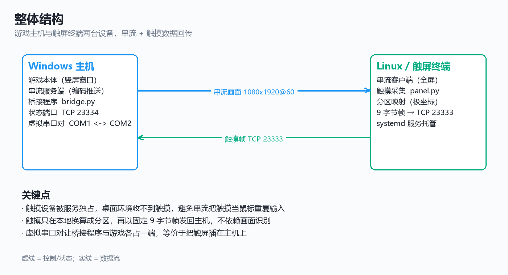
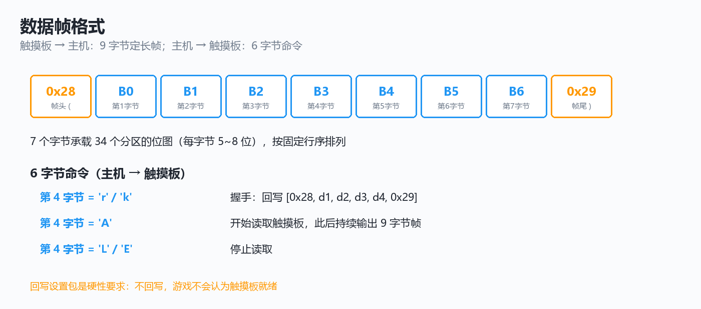
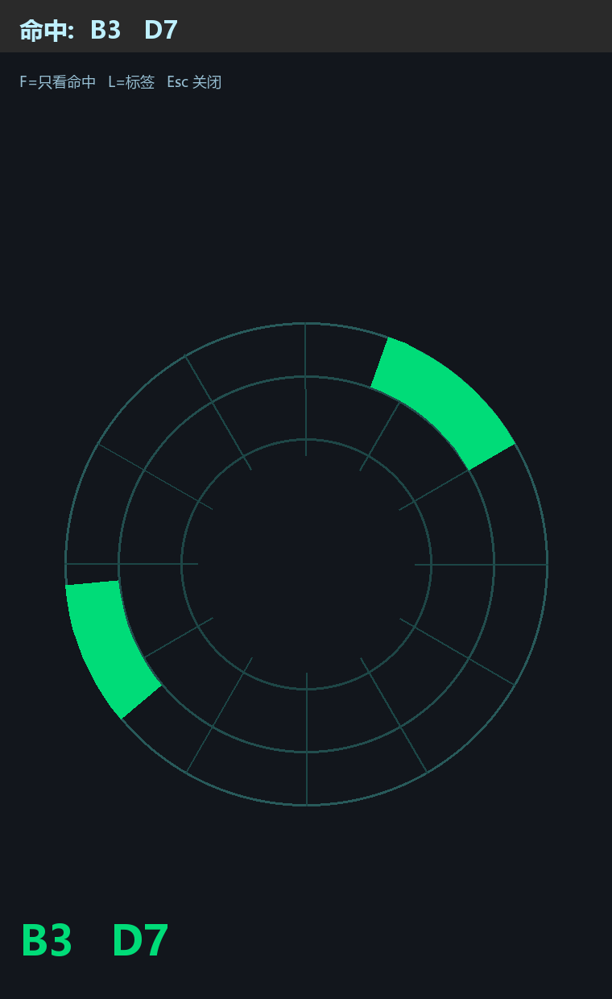
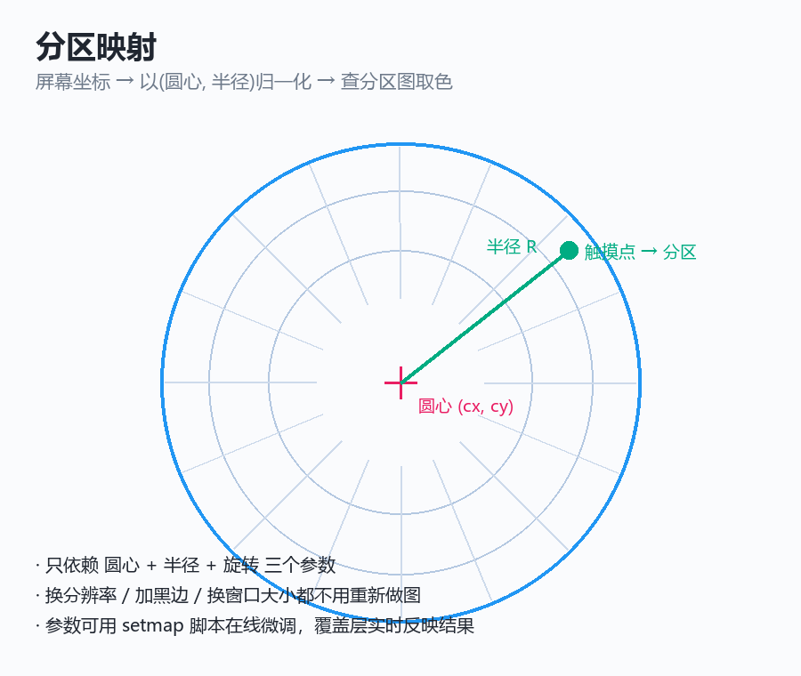

# majdata touch adapter

把一台带触控屏的平板 / 二合一设备变成 **PC 音游的触摸板**：
游戏跑在 Windows 主机上，串流到平板全屏显示，平板上按下的位置被换算成
游戏触摸板的 34 分区数据，经局域网 + 虚拟串口回传给游戏。

> 本项目只处理「触摸 → 分区 → 串口」这一层适配，不含任何游戏文件，
> 也不讨论任何具体游戏的安装与版本。



## 它解决什么问题

桌面上直接跑串流，平板上的触摸会被当成**鼠标点击**发给主机 —— 音游要的是
"在第几个扇区按下"，不是鼠标坐标。于是：

| 常规串流 | 本项目 |
|---|---|
| 触摸 = 鼠标，点哪算哪 | 触摸 = 分区位图，扇区级精度 |
| 多点触控基本丢失 | 支持同时多个分区 |
| 菜单能点，谱面打不了 | 谱面/菜单都能用 |

做法是：**在平板本地独占触摸设备**（桌面环境收不到，也就不会再被转发成鼠标），
把它换算成固定的 9 字节帧发回主机，主机再用一对虚拟串口喂给游戏。



## 结构

```
Windows 主机                                  Linux / 触屏终端
────────────                                  ────────────────
游戏（竖屏窗口）                                串流客户端（全屏）
串流服务端（编码推送）  ──── 画面 1080x1920 ───▶
                                                    │ 触摸事件（独占）
bridge.py  ◀──── 触摸帧 TCP 23333 ────────────  panel.py（分区换算）
   │                                                │
虚拟串口对 COM1 <-> COM2  →  游戏                    状态机 / systemd
```

| 组件 | 位置 | 职责 |
|---|---|---|
| `panel.py` | Linux | 读多点触控设备 → 归一化 → 旋转 → 极坐标查分区 → 9 字节帧 → TCP |
| `bridge.py` | Windows | TCP → 虚拟串口；处理 6 字节握手；1000 Hz 刷帧；状态端口 23334 |
| `hud.py` | Windows | 分区状态覆盖层（**调试用，默认关**，纯 GDI 实现） |
| `monitor.ps1` | Windows | 守护：游戏一退出就停服务并把屏幕恢复成启动前的方向 |
| `check.ps1` | Windows | 启动前自检（目录 / 运行环境 / 串口 / 配置 / 串流服务） |

## 画面 & 覆盖层

调试时可以打开分区覆盖层，直观看到"手指按到了哪一区"：



```bat
run.bat /hud          :: 本次临时打开
overlay-toggle.bat    :: 长期开 / 关（写 tool\hud.ini）
```

默认 `hud=0`：调好映射后关掉，画面干净，不占性能。

## 分区映射



映射只依赖三个参数：**圆心**、**半径**、**旋转**。
换分辨率、加黑边、改窗口大小都不需要重做图，用脚本在线微调即可。

## 快速开始

### 1. Windows 主机

1. 装一款能创建**成对互通**虚拟串口的软件，把 `COM1` 与 `COM2` 配成一对
2. 装串流服务端（[Sunshine](https://github.com/LizardByte/Sunshine)）
3. 把 `run.bat` + `tool\` 放进游戏根目录（与 `Package` 同级），双击 `run.bat`

`check.ps1` 会先自检，缺什么直接告诉你补什么。详见 [docs/02-windows.md](docs/02-windows.md)。

### 2. Linux / 触屏终端

```bash
./install.sh --host <主机IP>     # 先自检：依赖 / 触屏设备 / 串流客户端 / 连通性
~/start.sh                       # 起触摸服务 + 全屏串流
~/stop.sh                        # 停止并释放触屏
```

详见 [docs/03-linux.md](docs/03-linux.md)。

### 3. 校准

```bash
python3 ~/setmap.py                 # 看当前圆心/半径/旋转
python3 ~/setmap.py --cy 1385 --r 535
```

详见 [docs/04-calibration.md](docs/04-calibration.md)；
踩过的坑都在 [docs/05-troubleshooting.md](docs/05-troubleshooting.md)。

## 一键包

| 平台 | 文件 | 说明 |
|---|---|---|
| Windows | `majdata-touch-windows.zip` | 含内置运行时，解压即用，不用装 Python |
| Linux | `majdata-touch-linux.tar.gz` | 安装脚本会先自检环境 |

## 已知限制

* 触摸设备被独占期间，这台设备不能当普通触屏用（`stop.sh` 会释放）
* 分区精度取决于映射参数，先用覆盖层调准再关掉
* 只做了「触摸板」这一路；按键（1~8）仍需游戏侧按键映射方案

## 许可

代码 MIT，见 [LICENSE](LICENSE)。
第三方项目与素材的署名见 [CREDITS.md](CREDITS.md)。
